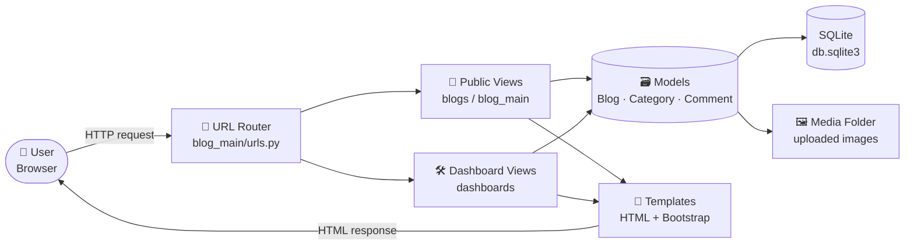
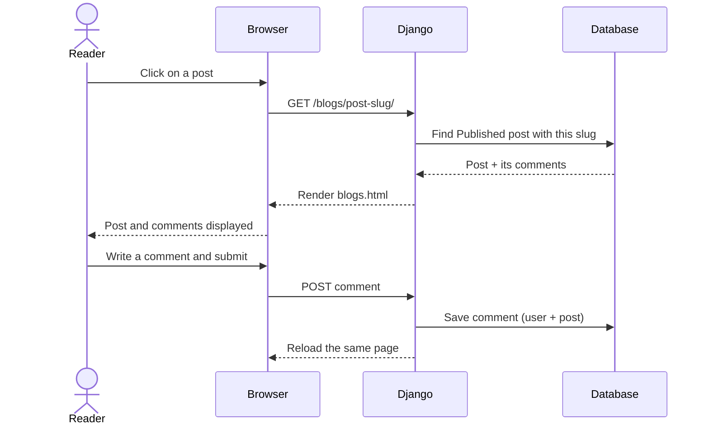
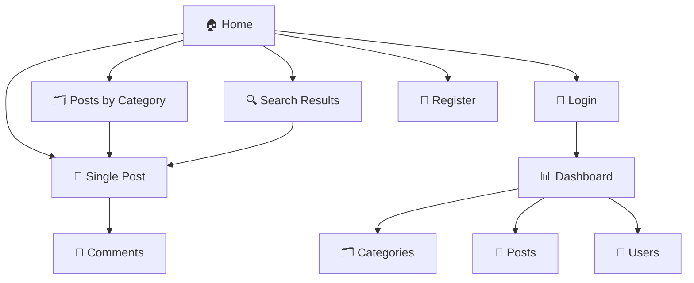
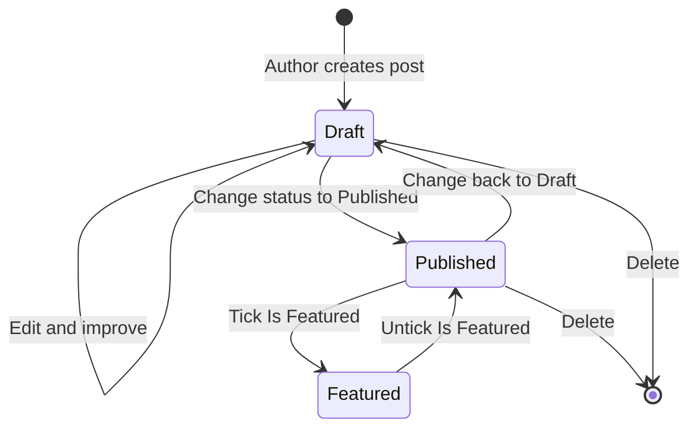
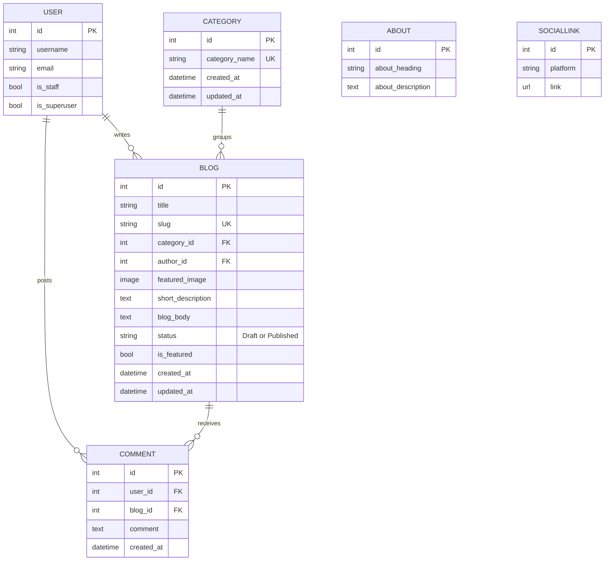
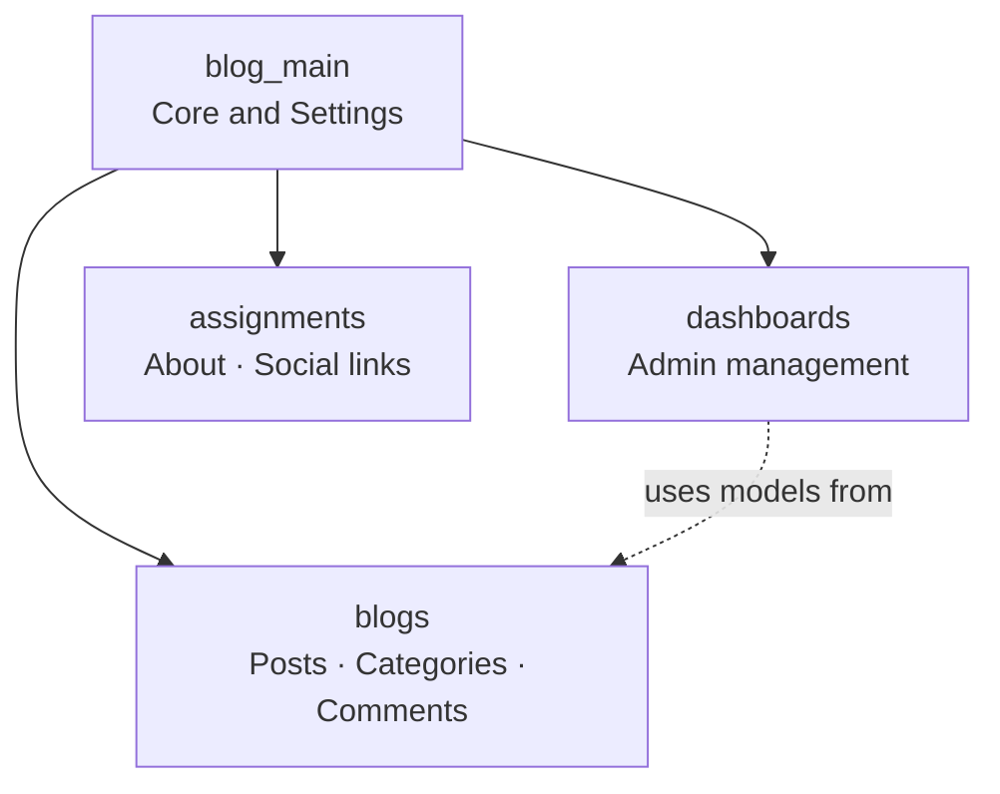

# 📝 Blog Management System


> **A complete blogging platform built with Django.**
> Readers get a clean public blog. Authors and admins get their own dashboard to write, organise and manage everything.

---

## 📑 Table of Contents

1. [What is this project?](#-what-is-this-project)
2. [Features at a glance](#-features-at-a-glance)
3. [How the system works](#-how-the-system-works)
4. [Who can do what](#-who-can-do-what)
5. [Life of a blog post](#-life-of-a-blog-post)
6. [Database design](#-database-design)
7. [Interface preview](#-interface-preview)
8. [Project structure](#-project-structure)
9. [Tech stack](#-tech-stack)
10. [Installation guide](#-installation-guide)
11. [Pages and URLs](#-pages-and-urls)
12. [Roadmap](#-roadmap)
13. [Contributing](#-contributing)
14. [Author](#-author)

---

## 🎯 What is this project?

Most blogs mix reading and writing on the same screen. This project **splits them in two**:

| Part | Who uses it | What it does |
|------|-------------|--------------|
| 🌐 **Public Blog** | Everyone | Read posts, search, browse by category, comment |
| 🛠️ **Dashboard** | Staff / admins | Create posts, manage categories, manage users |

No dependency on the default Django admin for daily work. The dashboard is custom-built for blogging.

---

## ✨ Features at a glance

### 🌐 For readers
- 🏠 Home page with **featured posts** and the latest posts
- 🗂️ Browse posts **by category**
- 🔍 **Search** by title, description or content
- 🔗 Clean, readable post links (for example `/blogs/my-first-post-1/`)
- 👤 **Register, log in and log out**
- 💬 **Comment** on any post
- ℹ️ About section and social media links in the footer
- 🚫 Friendly custom 404 page

### 🛠️ For admins and authors
- 📊 Dashboard showing total **categories** and **posts**
- ➕ Add, ✏️ edit and 🗑️ delete **categories**
- ➕ Add, ✏️ edit and 🗑️ delete **posts** with image upload
- 📝 **Draft / Published** control, so unfinished work stays hidden
- ⭐ Mark any post as **Featured** to show it on the home page
- 👥 Manage **users**: create, edit, delete, assign groups and permissions

---

## 🧭 How the system works

### Big picture



### What happens when someone opens a post



### Which page leads where



---

## 🔐 Who can do what

| Action | 👀 Visitor | 👤 Logged-in user | 🛠️ Staff / Admin |
|--------|:---------:|:-----------------:|:----------------:|
| Read published posts | ✅ | ✅ | ✅ |
| Search and browse categories | ✅ | ✅ | ✅ |
| Register / Login | ✅ | ✅ | ✅ |
| Comment on posts | ❌ | ✅ | ✅ |
| Open dashboard | ❌ | ✅ | ✅ |
| Manage categories and posts | ❌ | ❌ | ✅ |
| Manage users | ❌ | ❌ | ✅ |

> The main dashboard page requires login, and the **Users** menu appears only for accounts with permission to view users.

---

## 🔄 Life of a blog post



| Status | Visible to readers? | Shows in search? | Shows on home page? |
|--------|:-------------------:|:----------------:|:-------------------:|
| **Draft** | ❌ | ❌ | ❌ |
| **Published** | ✅ | ✅ | ✅ (recent list) |
| **Published + Featured** | ✅ | ✅ | ✅ (featured section) |

---

## 🗃️ Database design



**In simple words**
- One **category** holds many **posts**.
- One **user** can write many **posts** and many **comments**.
- One **post** can have many **comments**.
- **About** and **SocialLink** are small tables used only for the footer.

---

## 🖼️ Interface preview

### Home page
```text
╔══════════════════════════════════════════════════════════════════╗
║  Django Blog              [ Search...        ][ Go! ]  Login  Register ║
╠══════════════════════════════════════════════════════════════════╣
║  Technology   Sports   Travel   Lifestyle   Education            ║
╠══════════════════════════════════════════════════════════════════╣
║  ┌────────────────────────────────────────────────────────────┐  ║
║  │ ⭐ FEATURED                                                 │  ║
║  │ Ideas worth reading, stories worth sharing                 │  ║
║  │ Continue reading ...                                       │  ║
║  └────────────────────────────────────────────────────────────┘  ║
║                                                                  ║
║  RECENT POSTS                                                    ║
║  ┌──────────────────────────┐   ┌──────────────────────────┐     ║
║  │ TECHNOLOGY        [image]│   │ SPORTS            [image]│     ║
║  │ Getting started...       │   │ Why T20 changed...       │     ║
║  │ Continue reading         │   │ Continue reading         │     ║
║  └──────────────────────────┘   └──────────────────────────┘     ║
╠══════════════════════════════════════════════════════════════════╣
║  About us                                     Follow: GitHub ... ║
╚══════════════════════════════════════════════════════════════════╝
```

### Single post page
```text
╔══════════════════════════════════════════════════════════════════╗
║  [ SPORTS ]                                                      ║
║  Why T20 changed cricket forever                                 ║
║  By admin  |  Oct 09                                             ║
║  ┌────────────────────────────────────────────────────────────┐  ║
║  │                      FEATURED IMAGE                        │  ║
║  └────────────────────────────────────────────────────────────┘  ║
║  Post content goes here ...                                      ║
║                                                                  ║
║  💬 Comments (2)                                                 ║
║   ravi   - Great breakdown!                                      ║
║   priya  - Please write more on this.                            ║
║  ┌────────────────────────────────────────────────────────────┐  ║
║  │ Write a comment ...                                        │  ║
║  └────────────────────────────────────────────────────────────┘  ║
║                                                   [ Comment ]    ║
╚══════════════════════════════════════════════════════════════════╝
```

### Dashboard
```text
╔═══════════════╦══════════════════════════════════════════════════╗
║  📊 Dashboard ║  Logged in as admin                              ║
║  👥 Users     ║                                                  ║
║  🗂️ Categories║   ┌─────────────────┐   ┌─────────────────┐      ║
║  📄 Posts     ║   │ ALL CATEGORIES  │   │    ALL POSTS    │      ║
║  🚪 Logout    ║   │       5         │   │       12        │      ║
║               ║   └─────────────────┘   └─────────────────┘      ║
╚═══════════════╩══════════════════════════════════════════════════╝
```

### Manage posts
```text
╔═══════════════╦══════════════════════════════════════════════════╗
║  📊 Dashboard ║  Posts                         [ + Add new post ]║
║  👥 Users     ║  ──────────────────────────────────────────────  ║
║  🗂️ Categories║  #  Title            Category   Status   Action  ║
║  📄 Posts  ◄  ║  1  Getting started  Tech       Published Edit Delete ║
║  🚪 Logout    ║  2  Why T20 changed  Sports     Published Edit Delete ║
║               ║  3  Weekend escapes  Travel     Draft     Edit Delete ║
╚═══════════════╩══════════════════════════════════════════════════╝
```

---

## 📂 Project structure

```text
Blog-Management-System/
│
├── 📁 blog_main/            Project core
│   ├── settings.py          Configuration
│   ├── urls.py              Main URL routes
│   ├── views.py             Home, register, login, logout
│   ├── forms.py             Registration form
│   └── static/              CSS and images
│
├── 📁 blogs/                Public blog app
│   ├── models.py            Category, Blog, Comment
│   ├── views.py             Category page, post page, search
│   └── context_processors.py   Shares categories and social links on every page
│
├── 📁 dashboards/           Management dashboard app
│   ├── views.py             CRUD for categories, posts, users
│   ├── forms.py             Post, category and user forms
│   └── urls.py              Dashboard routes
│
├── 📁 assignments/          Footer content
│   └── models.py            About, SocialLink
│
├── 📁 templates/            HTML pages
│   └── 📁 dashboard/        Dashboard pages
│
├── 📁 media/                Uploaded post images
├── manage.py                Django command tool
└── requirements.txt         Python packages
```

### How the apps connect



---

## 🧰 Tech stack

| Layer | Technology | Purpose |
|-------|-----------|---------|
| Language | Python 3.10+ | Core programming language |
| Framework | Django | Backend, routing, authentication |
| Frontend | HTML, CSS, Bootstrap 4 | Layout and styling |
| Forms | django-crispy-forms, crispy-bootstrap4 | Nicely styled forms |
| Images | Pillow | Image upload handling |
| Database | SQLite3 | Default lightweight database |

---

## 🚀 Installation guide

### Requirements
- Python 3.10 or higher
- pip
- Git

### Steps

**1. Clone the project**
```bash
git clone https://github.com/Njbalamani/Blog-Management-System.git
cd Blog-Management-System
```

**2. Create a virtual environment**
```bash
python -m venv venv
```
Activate it:
```bash
# Windows
venv\Scripts\activate

# macOS / Linux
source venv/bin/activate
```

**3. Install packages**
```bash
pip install -r requirements.txt
```

**4. Set up the database**
```bash
python manage.py migrate
```

**5. Create an admin account**
```bash
python manage.py createsuperuser
```

**6. Start the server**
```bash
python manage.py runserver
```

**7. Open in browser**

👉 http://127.0.0.1:8000/

### First-time setup checklist
- [ ] Log in at `/login/` with your admin account
- [ ] Go to `/dashboard/categories/` and add a few categories
- [ ] Go to `/dashboard/posts/` and add your first post (set status to **Published**)
- [ ] Open `/admin/` and add an **About** entry and your **Social links**

---

## 🔗 Pages and URLs

| Page | URL |
|------|-----|
| Home | `/` |
| Posts by category | `/category/<id>/` |
| Single post | `/blogs/<slug>/` |
| Search | `/search/?keyword=your-word` |
| Register | `/register/` |
| Login | `/login/` |
| Logout | `/logout/` |
| Dashboard home | `/dashboard/` |
| Manage categories | `/dashboard/categories/` |
| Manage posts | `/dashboard/posts/` |
| Manage users | `/dashboard/users/` |
| Django admin | `/admin/` |

---

## 🛣️ Roadmap

- [ ] Restrict every dashboard page to staff users
- [ ] Make delete actions POST-only with CSRF protection
- [ ] Rich text editor for writing posts
- [ ] Pagination for post lists and search
- [ ] Keep secret key and debug mode in environment variables
- [ ] Deployment guide (Gunicorn + PostgreSQL)

---

## 🤝 Contributing

1. Fork this repository
2. Create a branch: `git checkout -b feature/your-feature`
3. Commit changes: `git commit -m "Add your feature"`
4. Push: `git push origin feature/your-feature`
5. Open a Pull Request

---

## 👤 Author

**N.J. Bala Mani Kantan**

[](https://github.com/Njbalamani)

---

⭐ **If this project helped you, please give it a star!**
